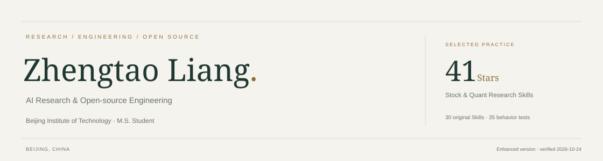

[English](README.md) | [中文](README.zh.md)

<picture>
  <source media="(prefers-color-scheme: dark)" srcset=".github/profile-cover-dark.svg" />
  
</picture>

# Zhengtao Liang | AI Research & Open-Source Engineering

M.S. student in Intelligent Science and Technology at **Beijing Institute of Technology** (2026 cohort). I work on legal AI and multimodal model safety, and build developer tools and applications.

**1 KSEM conference paper (CCF-C)** · Huawei ICT Competition: National First Prize

[Portfolio](https://serennity007.github.io/Serennity007-portfolio/) · [中文简历](https://serennity007.github.io/Serennity007-portfolio/resume.html) · [English Resume](https://serennity007.github.io/Serennity007-portfolio/resume-en.html) · [Email](mailto:1392452425a@gmail.com)

## Research & Background

- **KSEM · CCF-C**: 1 conference paper. [CCF classification](https://www.ccf.org.cn/c/2017-04-25/592085.shtml).
- **Research**: legal judgment prediction with LLMs, knowledge and precedent retrieval, and multimodal model safety alignment.
- **Education**: B.S. in AI, Guizhou University; rank **1/69**, GPA **4.14/5**. M.S. at BIT.
- **Honors & international experience**: National Scholarship; Huawei ICT National First Prize; NUS exchange; IELTS 6.5.

## Featured: Stock Screening & Quant Research

**[GitHub: 41 Stars · 8 Forks (as of 2026-10-24)](https://github.com/Serennity007/awesome-stock-quant-skills/stargazers)**

- Develop 30 original stock-screening and quant-research Skills in the enhanced version, covering financial filters, factor ranking, multi-framework consensus and backtesting with transaction costs.
- Hands-on validation: AKShare 1.19.3 retrieved real financial data and completed screening for 600519 across FY2021–2025; 35 behavioral tests passed, covering valuation dates, missing financials, turnover and costs.
- [Enhanced version & validation](https://github.com/Serennity007/awesome-stock-quant-skills/blob/c46da26575289ddaab5587d31e7f718f9ac22a2e/docs/validation.md) · [Original live-data run](https://github.com/Serennity007/awesome-stock-quant-skills/blob/c46da26575289ddaab5587d31e7f718f9ac22a2e/examples/verification/2026-10-24/buffett-check.json)

## Selected Projects

Selected for concrete functionality, source code and reusable workflows.

| Project | Implementation | Stack |
|---|---|---|
| **[Quant Research Skills](https://github.com/Serennity007/awesome-stock-quant-skills)** `awesome-stock-quant-skills` | 30 original Skills (enhanced version); financial screening, consensus ranking and cost-aware backtesting. 41 Stars / 8 Forks as of 2026-10-24. Real-data smoke run and 35 behavioral tests documented. | Python · akshare · pandas · Agent Skills |
| **[Exam Builder & Assessment System](https://github.com/Serennity007/paper-builder-system)** `paper-builder-system` | Build a Flask + SQLite application for question banks, exam assembly, student answers, objective grading, teacher review and score reports, with offline math rendering and Excel import/export. | Flask · SQLite · JavaScript · KaTeX |
| **[PPT Refactoring & Validation Workflow](https://github.com/Serennity007/beiligong-ppt-skill)** `beiligong-ppt-skill` | Standardize slide titles, colors and typography with Python; measure text overflow in PowerPoint, adjust font sizes and produce audit reports with regression checks. | Python · python-pptx · PowerPoint |
| **[Beijing Guizhou Food Map](https://github.com/Serennity007/beijing-food-map-workspace)** `beijing-food-map-workspace` | Provide a source snapshot with a React web app, API, SQLite data layer and Taro mini program for map-based restaurant discovery and feedback; the demo uses synthetic data. | TypeScript · React · SQLite · Taro |
| **[AI Agent Session Analytics CLI](https://github.com/Serennity007/agent-trace)** `agent-trace` | Parse local coding-agent session logs and report token usage, estimated costs and tool calls through terminal and JSON output. | Node.js · JavaScript · CLI |
| **[Finance RSS Reader & Digest Tools](https://github.com/Serennity007/serenity-stock-rss)** `serenity-stock-rss` | Adapt Qiaomu AI RSS into an Obsidian finance reader with 45 feeds, Markdown saving, daily-note excerpts and OPML; build a companion Feishu digest tool with deduplication, grouped cards and batched delivery. | TypeScript · Obsidian API · Node.js |

[Food map demo (synthetic data)](https://serennity007.github.io/beijing-food-map/) · [Repository catalog](https://github.com/Serennity007/repo-catalog) · [All repositories](https://github.com/Serennity007/?tab=repositories)

## CLI Tools

| Tool | Purpose | Command |
|---|---|---|
| [agent-trace](https://github.com/Serennity007/agent-trace) | Local agent session analytics | `npx @liangzhengtao/agent-trace` |
| [git-format](https://github.com/Serennity007/git-format) | Rule-based commit message formatting | `npx @liangzhengtao/git-format --dry-run` |
| [ai-commit](https://github.com/Serennity007/ai-commit) | Generate messages from Git diffs | `npx @liangzhengtao/commit-ai` |
| [vibe-check](https://github.com/Serennity007/vibe-check) | Check AI coding configuration | `npx @liangzhengtao/vibe-check` |

## Engineering Focus

**AI / Data**: Python · PyTorch · Transformers · RAG · Milvus · pandas 
**Applications**: TypeScript · JavaScript · React · Flask · FastAPI · SQLite 
**Workflows**: Git · Node.js CLI · Agent Skills · PowerPoint automation · GitHub Actions

GitHub activity

<picture>
  <source media="(prefers-color-scheme: dark)" srcset="https://cdn.jsdelivr.net/gh/Serennity007/Serennity007@output/animal-snake-dark.svg" />
  <source media="(prefers-color-scheme: light)" srcset="https://cdn.jsdelivr.net/gh/Serennity007/Serennity007@output/animal-snake.svg" />
  
</picture>

---

Interested in research collaboration or AI engineering? Reach me at [1392452425a@gmail.com](mailto:1392452425a@gmail.com).
