[English](README.md) | [中文](README.zh.md)

# 梁正涛 | AI 研究与开源工程

**北京理工大学**智能科学与技术硕士在读（2026 级），研究方向为法律 AI 与多模态大模型安全对齐，同时开发 AI 工具和应用系统。

**KSEM（CCF-C）会议论文 1 篇** · 华为 ICT 大赛国家一等奖 / 全球三等奖

[作品集](https://serennity007.github.io/Serennity007-portfolio/) · [中文简历](https://serennity007.github.io/Serennity007-portfolio/resume.html) · [English Resume](https://serennity007.github.io/Serennity007-portfolio/resume-en.html) · [Email](mailto:1392452425a@gmail.com)

## 科研与背景

- **KSEM · CCF-C**: 会议论文 1 篇。[CCF 会议分类](https://www.ccf.org.cn/c/2017-04-25/592085.shtml)。
- **研究方向**: 大语言模型法律判决预测、法律知识与先例检索、多模态大模型安全对齐。
- **教育背景**: 贵州大学人工智能本科，专业排名 **1/69**，GPA **4.14/5**；北京理工大学硕士在读。
- **荣誉与交流**: 国家奖学金；华为 ICT 国家一等奖、全球三等奖；新加坡国立大学交流；雅思 6.5。

## 重点项目：选股与量化研究

**[GitHub 41 Stars · 8 Forks（截至 2026-10-24）](https://github.com/Serennity007/awesome-stock-quant-skills/stargazers)**

- 开发 30 个原创选股与量化研究 Skill（增强版），覆盖财务筛选、因子排序、多框架共识和含交易成本的回测。
- 个人实测：AKShare 1.19.3 跑通 600519 真实财务取数与筛选计算，覆盖 2021–2025 年报；35 项行为测试通过，覆盖估值日期、财务缺失、换手与成本。
- [增强版与验证记录](https://github.com/Serennity007/awesome-stock-quant-skills/blob/c46da26575289ddaab5587d31e7f718f9ac22a2e/docs/validation.md) · [真实取数原始记录](https://github.com/Serennity007/awesome-stock-quant-skills/blob/c46da26575289ddaab5587d31e7f718f9ac22a2e/examples/verification/2026-10-24/buffett-check.json)

## 代表项目

精选具备具体功能、源码或可复用工作流的项目。

| 项目 | 做了什么 | 技术栈 |
|---|---|---|
| **[量化研究 AI Skills](https://github.com/Serennity007/awesome-stock-quant-skills)** `awesome-stock-quant-skills` | 30 个原创 Skill（增强版），覆盖财务筛选、共识排序与含成本回测；41 Stars / 8 Forks（截至 2026-10-24），附真实数据实跑和 35 项行为测试记录。 | Python · akshare · pandas · Agent Skills |
| **[国际课程组卷与在线考试系统](https://github.com/Serennity007/paper-builder-system)** `paper-builder-system` | 基于 Flask + SQLite 实现题库、双栏组卷、在线答题、客观题判分、教师批阅与成绩分析；支持离线公式渲染和 Excel 导入导出。 | Flask · SQLite · JavaScript · KaTeX |
| **[PPT 批量改造与验收工作流](https://github.com/Serennity007/beiligong-ppt-skill)** `beiligong-ppt-skill` | 使用 Python 批量统一课件标题、配色和字号；调用 PowerPoint 实测文本越框并回退，配套静态验收报告与回归测试。 | Python · python-pptx · PowerPoint |
| **[京城黔味地图](https://github.com/Serennity007/beijing-food-map-workspace)** `beijing-food-map-workspace` | 提供 React 网页、API、SQLite 数据层及 Taro 小程序的完整源码快照；实现地图找店与反馈流程，线上使用合成演示数据。 | TypeScript · React · SQLite · Taro |
| **[AI Agent 会话分析 CLI](https://github.com/Serennity007/agent-trace)** `agent-trace` | 解析多种编码 Agent 的本地会话日志，汇总 token 用量、成本估算与工具调用；提供终端报告与 JSON 输出。 | Node.js · JavaScript · CLI |
| **[财经 RSS 阅读器与摘要工具](https://github.com/Serennity007/serenity-stock-rss)** `serenity-stock-rss` | 基于 Qiaomu AI RSS 改造 Obsidian 财经阅读器，内置 45 个源，支持文章转 Markdown、日记摘录与 OPML；另开发飞书摘要工具，支持消息去重、分组卡片和分批发送。 | TypeScript · Obsidian API · Node.js |

[地图在线演示（合成数据）](https://serennity007.github.io/beijing-food-map/) · [仓库分类索引](https://github.com/Serennity007/repo-catalog) · [全部仓库](https://github.com/Serennity007/?tab=repositories)

## CLI 工具

| 工具 | 用途 | 使用入口 |
|---|---|---|
| [agent-trace](https://github.com/Serennity007/agent-trace) | 本地 Agent 会话分析 | `npx @liangzhengtao/agent-trace` |
| [git-format](https://github.com/Serennity007/git-format) | 按规则生成规范提交信息 | `npx @liangzhengtao/git-format --dry-run` |
| [ai-commit](https://github.com/Serennity007/ai-commit) | 根据 Git diff 生成提交信息 | `npx @liangzhengtao/commit-ai` |
| [vibe-check](https://github.com/Serennity007/vibe-check) | 检查 AI 编码配置 | `npx @liangzhengtao/vibe-check` |

## 工程能力

**AI / Data**: Python · PyTorch · Transformers · RAG · Milvus · pandas 
**Applications**: TypeScript · JavaScript · React · Flask · FastAPI · SQLite 
**Workflows**: Git · Node.js CLI · Agent Skills · PowerPoint automation · GitHub Actions

GitHub 活跃记录

<picture>
  <source media="(prefers-color-scheme: dark)" srcset="https://cdn.jsdelivr.net/gh/Serennity007/Serennity007@output/animal-snake-dark.svg" />
  <source media="(prefers-color-scheme: light)" srcset="https://cdn.jsdelivr.net/gh/Serennity007/Serennity007@output/animal-snake.svg" />
  
</picture>

---

科研合作与 AI 工程交流： [1392452425a@gmail.com](mailto:1392452425a@gmail.com).
